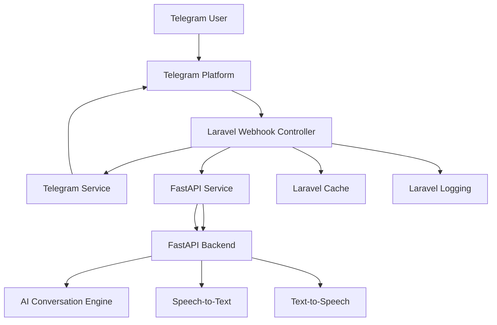
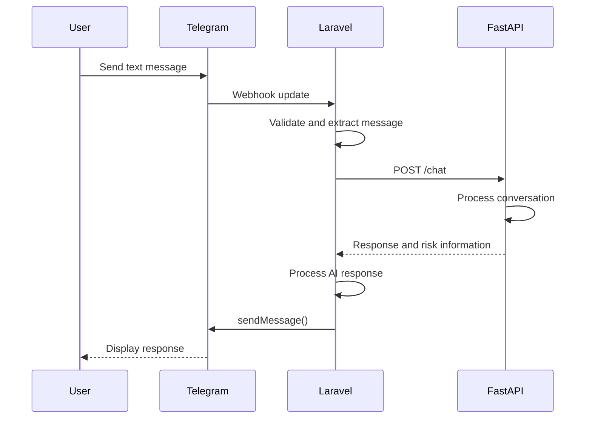
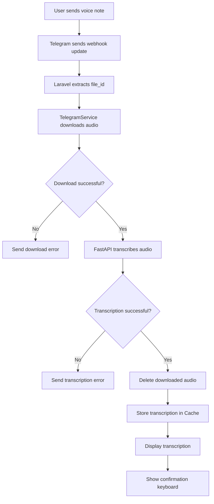
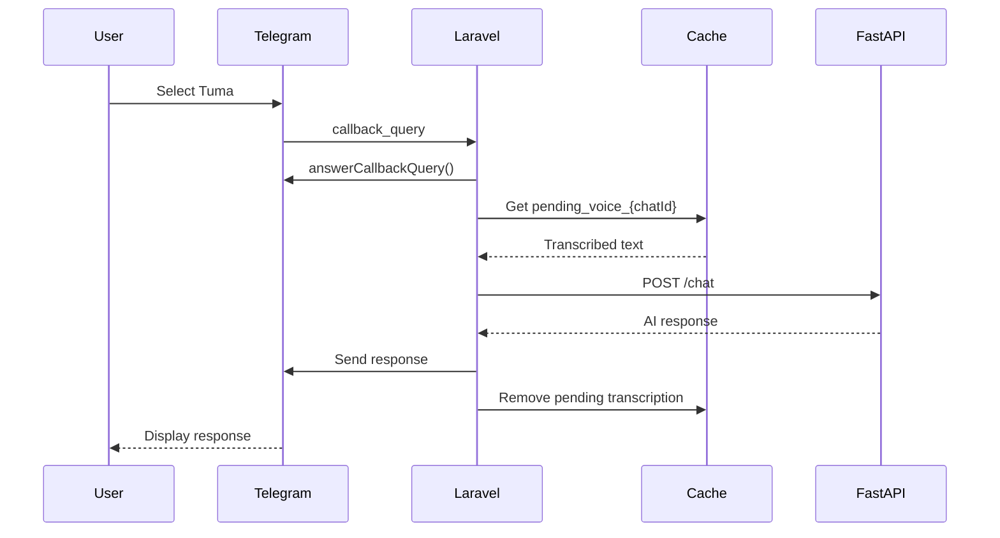

# Pregnancy Health Telegram Assistant

[t.me/Fuatamamabot](https://t.me/Fuatamamabot)

## 1. Project Overview

The Pregnancy Health Telegram Assistant is a conversational health-support application that allows users to interact with an AI-powered assistant through Telegram.

The application is designed to make pregnancy-related health information more accessible through natural-language conversations. Users can communicate with the assistant using either text messages or voice notes.

The system supports Swahili-language interactions and uses a separate AI backend to process messages, transcribe audio, generate responses and optionally convert text responses into speech.

The application is divided into two primary backend components:

1. **Laravel backend:** Responsible for Telegram integration, webhook processing, message handling, temporary conversation state, voice-message workflows, callback handling, logging and communication with the AI backend.
2. **FastAPI backend:** Responsible for AI-related operations, including conversational responses, audio transcription and text-to-speech generation.

Telegram serves as the primary user interface. Users do not need to install a separate mobile application or create an account on an independent web platform to interact with the assistant.

### 1.1 Project objectives

The system aims to:

- Provide an accessible conversational interface for pregnancy-related health information.
- Allow users to submit questions using text or voice.
- Support Swahili communication.
- Convert voice messages into text before processing them.
- Allow users to review and confirm transcribed voice messages before submission.
- Generate conversational AI responses.
- Optionally deliver AI responses as voice messages.
- Identify potentially high-risk conversations and initiate an appropriate escalation workflow.
- Keep Telegram-specific logic separate from AI-processing logic.
- Make the system maintainable and extensible through clearly separated backend responsibilities.

### 1.2 Scope

The application is intended to provide informational and conversational support.

It should not be treated as a replacement for:

- Professional medical diagnosis.
- Antenatal care.
- Emergency medical services.
- Clinical assessment by a qualified healthcare professional.
- Prescriptions or individualized medical treatment.

The AI assistant should communicate its limitations and direct users to qualified healthcare professionals when a question requires clinical assessment.

---

# 2. System Architecture

## 2.1 High-level architecture

The application uses a service-oriented architecture with Laravel acting as the integration and orchestration layer.



### 2.2 Component responsibilities

| Component | Responsibility |
|---|---|
| Telegram | Provides the messaging interface and delivers updates to the webhook. |
| TelegramWebhookController | Receives and interprets incoming Telegram updates. |
| TelegramService | Encapsulates Telegram Bot API operations. |
| FastApiService | Encapsulates HTTP communication with the FastAPI backend. |
| FastAPI `/chat` | Processes conversational messages and generates AI responses. |
| FastAPI `/transcribe` | Converts submitted audio into text. |
| FastAPI `/speak` | Converts generated text into audio. |
| Laravel Cache | Temporarily stores transcribed voice messages awaiting confirmation. |
| Laravel Logging | Records application events, failures and diagnostic information. |

The Laravel application should not implement AI processing directly inside the Telegram webhook controller. Instead, it should delegate those responsibilities to the FastAPI service.

Likewise, the FastAPI backend should not be responsible for receiving Telegram webhook updates or managing Telegram callback buttons.

This separation allows each backend component to evolve independently.

---

# 3. Technology Stack

The technologies identified in the current implementation are:

| Technology | Purpose |
|---|---|
| PHP | Laravel backend implementation language. |
| Laravel | Application framework, webhook processing, services, cache and logging. |
| Telegram Bot API | User messaging, voice messages and inline keyboards. |
| Python | FastAPI backend implementation language. |
| FastAPI | HTTP API for AI and audio-processing operations. |
| HTTP | Communication between Laravel and FastAPI. |
| Laravel Cache | Temporary storage for pending voice transcriptions. |
| Laravel Logging | Application diagnostics and operational monitoring. |

The specific AI model, speech-recognition engine, TTS engine, database engine and production infrastructure should be documented once confirmed from the implementation.

---

# 4. Laravel Backend Structure

The Laravel application is responsible for receiving Telegram updates and coordinating the processing of user messages.

The main components currently identified are:

```text
app/
└── Services/
    ├── TelegramService.php
    └── FastApiService.php

app/
└── Http/
    └── Controllers/
        └── TelegramWebhookController.php

config/
└── telegram.php
```

The actual project may contain additional controllers, models, jobs, middleware, routes and configuration files.

## 4.1 TelegramWebhookController

**File:** `app/Http/Controllers/TelegramWebhookController.php`

This controller is the entry point for Telegram updates.

Telegram sends an HTTP POST request to the registered webhook whenever an update is received.

The controller is responsible for:

1. Receiving the incoming update.
2. Validating and interpreting the update structure.
3. Identifying whether the update contains a text message, voice message or callback query.
4. Delegating Telegram operations to TelegramService.
5. Delegating AI operations to FastApiService.
6. Managing temporary conversation state.
7. Handling voice-message confirmation.
8. Processing AI-generated responses.
9. Handling risk-escalation results.
10. Recording relevant application logs.

The controller should coordinate workflows rather than contain the implementation details of external API integrations.

### 4.1.1 Incoming Telegram update types

The controller currently handles three important types of Telegram updates.

| Update type | Telegram payload | Purpose |
|---|---|---|
| Text message | `message.text` | Processes a normal text conversation. |
| Voice message | `message.voice` | Downloads, transcribes and confirms a voice message. |
| Callback query | `callback_query` | Processes inline keyboard interactions. |

A simplified controller structure looks like this:

```php
public function handle(Request $request)
{
    $update = $request->all();

    if (isset($update['callback_query'])) {
        // Process inline keyboard interaction.
    } elseif (isset($update['message']['text'])) {
        // Process a normal text message.
    } elseif (isset($update['message']['voice'])) {
        // Process a voice message.
    }

    return response()->json(['status' => 'ok']);
}
```

This is an architectural illustration, not a replacement for the actual controller implementation.

### 4.1.2 Webhook security

The webhook should verify the secret token configured with Telegram.

Telegram supports the `secret_token` parameter when registering a webhook. The configured token is sent in the HTTP header:

```text
X-Telegram-Bot-Api-Secret-Token
```

Laravel should compare the received value with the expected secret before processing the update.

This prevents arbitrary callers from submitting unauthenticated webhook payloads.

The secret must:

- Be stored in environment configuration.
- Never be committed to source control.
- Never be printed in application logs.
- Be rotated if exposed.

---

# 5. TelegramService

**File:** `app/Services/TelegramService.php`

TelegramService is responsible for all direct communication with the Telegram Bot API.

Its purpose is to isolate Telegram-specific HTTP operations from the application workflow.

The webhook controller should call methods on this service instead of constructing Telegram API URLs and HTTP requests directly.

## 5.1 Responsibilities

The currently identified operations include:

| Method | Responsibility |
|---|---|
| `sendMessage()` | Sends a text message to a Telegram chat. |
| `sendVoice()` | Sends an audio response as a Telegram voice message. |
| `getFile()` | Retrieves Telegram metadata for an uploaded file. |
| `downloadFile()` | Downloads a Telegram file to local storage. |
| `answerCallbackQuery()` | Acknowledges an inline keyboard callback. |
| `deleteMessage()` | Deletes a Telegram message. |

## 5.2 Telegram API URL structure

The Telegram Bot API uses the following URL structure:

```text
https://api.telegram.org/bot{BOT_TOKEN}/{METHOD}
```

For example:

```text
https://api.telegram.org/bot{BOT_TOKEN}/sendMessage
```

The bot token should be obtained from configuration:

```php
$this->token = config('telegram.token');
```

It should not be hardcoded in a service or controller.

## 5.3 Sending text messages

The `sendMessage()` method sends a text response to a Telegram chat.

Conceptually, the request contains:

```json
{
    "chat_id": 123456789,
    "text": "Karibu! Ninaweza kukusaidia kujifunza kuhusu afya wakati wa ujauzito.",
    "parse_mode": "Markdown"
}
```

When an inline keyboard is supplied, the method should include the appropriate `reply_markup` object.

For example:

```json
{
    "inline_keyboard": [
        [
            {
                "text": "Tuma",
                "callback_data": "confirm_voice"
            },
            {
                "text": "Andika Badala Yake",
                "callback_data": "edit_voice"
            }
        ],
        [
            {
                "text": "Futa",
                "callback_data": "cancel_voice"
            }
        ]
    ]
}
```

## 5.4 Sending voice messages

The `sendVoice()` method sends generated audio to a Telegram chat.

The audio file must be in a format supported by Telegram's voice-message API.

The current application uses an `.ogg` filename for voice responses.

The developer should verify that the generated audio is encoded in a Telegram-compatible format, such as OGG with Opus audio.

A file extension alone does not guarantee that the underlying audio encoding is correct.

## 5.5 Downloading Telegram voice files

Telegram does not include the actual audio bytes in a webhook update.

Instead, the update contains a `file_id`.

The application must:

1. Extract the `file_id` from `message.voice`.
2. Call Telegram's `getFile` method.
3. Read the returned `file_path`.
4. Download the file from Telegram's file endpoint.
5. Save the file locally.
6. Pass the local file path to FastApiService.

The Telegram file-download endpoint has the following structure:

```text
https://api.telegram.org/file/bot{BOT_TOKEN}/{file_path}
```

The downloaded file is then used for transcription.

## 5.6 Callback acknowledgements

Telegram inline keyboard interactions produce callback queries.

The application should acknowledge these callbacks using `answerCallbackQuery()`.

This informs Telegram that the callback has been received and prevents the client from continuing to display a pending callback indicator.

## 5.7 Error handling

TelegramService should account for:

- Network connection failures.
- Invalid bot tokens.
- Invalid chat identifiers.
- Missing or expired file references.
- Unsupported media formats.
- Telegram API errors.
- Rate limits.
- Failed file downloads.

Errors should be logged with useful contextual information, but bot tokens and other credentials must never be logged.

---

# 6. FastApiService

**File:** `app/Services/FastApiService.php`

FastApiService is the Laravel application's communication layer for the FastAPI backend.

It encapsulates HTTP requests to the AI backend.

The service currently exposes three operations:

| Method | FastAPI endpoint | Responsibility |
|---|---|---|
| `chat()` | `/chat` | Generates a conversational response. |
| `transcribe()` | `/transcribe` | Converts audio into text. |
| `speak()` | `/speak` | Converts text into audio. |

The FastAPI base URL is loaded through configuration:

```php
$this->baseUrl = rtrim(
    (string) config('telegram.fastapi_url', ''),
    '/'
);
```

The URL must be configured correctly. An unset URL should not silently be treated as a valid production endpoint.

## 6.1 Chat endpoint

The chat endpoint processes a user's message and returns an AI-generated response.

The general flow is:

```text
User message
    |
    v
Laravel TelegramWebhookController
    |
    v
FastApiService::chat()
    |
    v
POST /chat
    |
    v
FastAPI AI processing
    |
    v
AI-generated response
    |
    v
Laravel response handling
    |
    v
Telegram
```

### Expected request information

The request should contain the user's message and any other contextual information required by the FastAPI implementation.

An illustrative request could look like:

```json
{
    "message": "Habari, nina swali kuhusu afya wakati wa ujauzito.",
    "language": "sw"
}
```

This example is illustrative. The exact field names and required parameters must match the actual FastAPI endpoint.

### Expected response information

The Laravel integration currently expects the chat response to provide information that can be used to:

- Deliver the AI-generated message.
- Determine whether the conversation requires risk escalation.
- Identify the risk level.

An illustrative response structure is:

```json
{
    "response": "Karibu. Naweza kukusaidia kuelewa taarifa za jumla kuhusu afya wakati wa ujauzito.",
    "escalate": false,
    "risk_level": "low"
}
```

The actual FastAPI response schema must be confirmed before modifying either backend.

### Risk-related response fields

The following fields have been identified in the Laravel integration:

| Field | Purpose |
|---|---|
| `response` | AI-generated conversational response. |
| `escalate` | Indicates whether an escalation workflow should be initiated. |
| `risk_level` | Represents the risk classification returned by the AI backend. |

The Laravel application should interpret these fields consistently.

The AI backend's risk classification should not be treated as a clinical diagnosis or as a substitute for emergency assessment.

## 6.2 Transcription endpoint

The transcription endpoint converts an audio file into text.

Laravel sends the downloaded Telegram audio file to FastAPI using a multipart HTTP request.

The language parameter currently used by the Laravel implementation is:

```text
sw
```

This identifies Swahili as the requested transcription language.

The processing flow is:

```text
Telegram voice message
       |
       v
Telegram file_id
       |
       v
TelegramService::downloadFile()
       |
       v
Local audio file
       |
       v
FastApiService::transcribe()
       |
       v
POST /transcribe
       |
       v
Speech recognition
       |
       v
Transcribed text
       |
       v
Laravel Cache
```

### Expected response

The Laravel controller currently expects `transcribe()` to return transcribed text.

For example:

```text
Habari, ningependa kujua jinsi ya kutunza afya yangu wakati wa ujauzito.
```

The exact HTTP response structure used by FastAPI should be documented from the actual implementation.

The Laravel service should handle cases where:

- The audio file is missing.
- The file is empty.
- The audio format is unsupported.
- Transcription fails.
- No text is recognized.
- FastAPI is unavailable.
- The transcription request times out.

## 6.3 Text-to-speech endpoint

The `/speak` endpoint converts an AI-generated text response into an audio file.

The general processing flow is:

```text
AI-generated response
       |
       v
Laravel FastApiService::speak()
       |
       v
POST /speak
       |
       v
FastAPI text-to-speech processing
       |
       v
Generated audio
       |
       v
Laravel local audio file
       |
       v
TelegramService::sendVoice()
       |
       v
Telegram user
```

The generated audio must be saved to a temporary location accessible to the Laravel application.

After the voice message is sent, the temporary audio file should be cleaned up.

The existing Laravel response-processing logic removes the generated audio file after use.

**Important:** The mock implementation must not return the shared audio fixture directly if the controller deletes the returned file. It should copy the fixture to a unique temporary file first.

---

# 7. User Interaction Workflows

This section describes how the backend processes each type of user interaction.

## 7.1 Starting a conversation

A user starts the bot using Telegram's `/start` command.

The update contains a normal Telegram text message:

```json
{
    "message": {
        "text": "/start"
    }
}
```

The controller identifies the command and sends the welcome message.

The welcome message should explain:

- The assistant's purpose.
- That users can ask pregnancy-related health questions.
- That they can communicate using text or voice.
- That the assistant provides informational support rather than a clinical diagnosis.
- How users can access professional medical assistance when necessary.

The actual welcome message should be maintained consistently rather than duplicated across unrelated controller methods.

## 7.2 Normal text conversation

This is the simplest interaction flow.

### Processing steps

1. Telegram receives a text message from the user.
2. Telegram sends an update to the Laravel webhook.
3. Laravel validates the webhook request.
4. TelegramWebhookController extracts the chat ID and message text.
5. Laravel logs the incoming message event.
6. FastApiService sends the message to `/chat`.
7. FastAPI processes the message.
8. FastAPI returns the generated response and risk information.
9. Laravel processes the returned response.
10. Laravel sends the response to the Telegram user.
11. If the response requires escalation, the escalation workflow is initiated.

### Flow diagram



## 7.3 Voice-message conversation

Voice interaction has additional processing steps because Telegram supplies a file reference rather than the transcribed content.

The workflow consists of two stages:

1. Voice transcription and confirmation.
2. Submission of the confirmed text to the AI backend.

This separation allows the user to inspect the transcription before the assistant processes it.

### Stage 1: Receiving the voice message

When a user sends a voice note, Telegram produces an update containing:

```json
{
    "message": {
        "voice": {
            "duration": 8,
            "mime_type": "audio/ogg",
            "file_id": "TELEGRAM_FILE_ID",
            "file_unique_id": "UNIQUE_FILE_ID",
            "file_size": 24576
        }
    }
}
```

The important property is:

```text
message.voice.file_id
```

This identifier is used to download the audio from Telegram.

### Stage 2: Downloading the audio

The controller calls:

```php
$localAudioPath = $this->telegram->downloadFile($fileId);
```

TelegramService handles the actual Telegram API interaction.

If the download fails, the controller sends an error message to the user and terminates the voice-processing workflow.

### Stage 3: Transcribing the audio

After downloading the file, the controller calls:

```php
$transcribedText = $this->fastApi->transcribe(
    $localAudioPath,
    'sw'
);
```

The audio file is sent to FastAPI for Swahili transcription.

The returned text is used in the next stage.

### Stage 4: Cleaning up the downloaded audio

Once the transcription request has completed, Laravel deletes the downloaded audio file:

```php
$fileDeleted = @unlink($localAudioPath);
```

This prevents downloaded audio files from accumulating indefinitely.

A production implementation should also consider cleanup when an exception occurs before normal execution reaches the deletion statement.

### Stage 5: Storing the transcription temporarily

The transcribed text is stored in Laravel Cache:

```php
Cache::put(
    "pending_voice_{$chatId}",
    $transcribedText,
    now()->addMinutes(5)
);
```

The cache key follows this format:

```text
pending_voice_{chatId}
```

Example:

```text
pending_voice_123456789
```

The transcription expires after five minutes.

This is temporary state, not permanent conversation history.

### Why temporary storage is used

The application needs to remember the transcription while the user decides whether to submit it.

Cache avoids requiring a database record for every unconfirmed transcription.

It also ensures that the confirmation process does not need to resend the original audio to FastAPI.

### Stage 6: Requesting user confirmation

After saving the transcription, Laravel sends a confirmation message.

The message contains the recognized text and three inline keyboard actions:

| Button | Callback data | Meaning |
|---|---|---|
| Tuma | `confirm_voice` | Submit the transcription to the AI assistant. |
| Andika Badala Yake | `edit_voice` | Discard the pending voice transcription and allow text entry. |
| Futa | `cancel_voice` | Cancel the pending voice interaction. |

The user is therefore able to inspect the transcription before it becomes an AI conversation message.

### Complete voice flow



---

# 8. Voice Confirmation and Callback Processing

The confirmation stage is an important part of the application's conversational workflow.

Telegram inline keyboard buttons generate callback queries rather than ordinary text messages.

The controller must therefore handle `callback_query` updates separately.

## 8.1 Confirm voice: `confirm_voice`

When the user selects **Tuma**, Telegram sends a callback query containing:

```json
{
    "callback_query": {
        "id": "CALLBACK_QUERY_ID",
        "data": "confirm_voice"
    }
}
```

The expected backend workflow is:

1. Extract the callback query.
2. Extract the user's chat identifier from the callback message.
3. Acknowledge the callback through TelegramService.
4. Retrieve the pending transcription from Cache.
5. Check whether the transcription still exists.
6. If it has expired or is missing, inform the user.
7. Otherwise, submit the transcribed text to FastAPI `/chat`.
8. Process the AI response.
9. Send the response to Telegram.
10. Clear the pending transcription.

The cache lookup uses:

```php
$transcribedText = Cache::get(
    "pending_voice_{$chatId}"
);
```

The confirmation action should not process the same pending message repeatedly.

For reliable handling, consider deleting or marking the pending entry as consumed before or during processing, with suitable failure handling.

## 8.2 Edit voice: `edit_voice`

When the user selects **Andika Badala Yake**, the application should:

1. Acknowledge the callback.
2. Remove the pending voice transcription.
3. Remove or update the confirmation prompt as appropriate.
4. Ask the user to submit the corrected message as text.

Example:

```php
Cache::forget("pending_voice_{$chatId}");
```

The purpose is to allow the user to correct transcription errors before the AI backend processes the message.

## 8.3 Cancel voice: `cancel_voice`

When the user selects **Futa**, the application should:

1. Acknowledge the callback.
2. Remove the pending transcription.
3. Remove the confirmation prompt if supported by the current workflow.
4. Send a cancellation acknowledgement.

Example:

```php
Cache::forget("pending_voice_{$chatId}");
```

## 8.4 Callback sequence diagram



The other two buttons follow different branches and should not invoke the AI chat endpoint.

---

# 9. AI Response Processing

The controller contains response-processing logic that handles the result returned by FastAPI.

The existing implementation includes a method named:

```php
processApiResponse()
```

This is an important point in the backend workflow because the AI response may involve more than simply sending text.

The method should be understood as the place where Laravel translates the FastAPI result into user-facing Telegram actions.

Its responsibilities include the operations currently implemented for:

- Extracting the generated response.
- Handling risk-related response information.
- Sending a text response.
- Generating optional speech using FastAPI `/speak`.
- Sending generated audio using Telegram `sendVoice()`.
- Cleaning up temporary generated audio.

The exact conditions under which voice responses are generated should be documented from the actual method implementation.

## 9.1 Response delivery

At a high level:

```text
FastAPI response
      |
      v
processApiResponse()
      |
      +----> Extract response text
      |
      +----> Process risk information
      |
      +----> Send Telegram text
      |
      +----> Optional text-to-speech
                    |
                    v
              Save generated audio
                    |
                    v
              Send Telegram voice
                    |
                    v
              Delete temporary audio
```

The backend developer should preserve the established response contract when modifying this logic.

---

# 10. Risk Detection and Escalation

The application has a risk-related response mechanism.

FastAPI returns information indicating whether a conversation requires escalation.

The currently identified response fields are:

```json
{
    "escalate": true,
    "risk_level": "high"
}
```

The Laravel backend consumes this information when processing the AI response.

## 10.1 Separation of responsibilities

The AI backend is responsible for generating the risk-related classification.

The Laravel backend is responsible for carrying out the application-level escalation workflow.

This distinction is important.

Laravel should not independently invent a clinical risk classification based solely on arbitrary text unless an explicitly designed and validated rule system is introduced.

## 10.2 Escalation considerations

The system should distinguish between:

- General pregnancy-health questions.
- Questions requiring additional professional guidance.
- Potentially urgent symptoms or situations.
- Requests that fall outside the assistant's informational scope.

For potentially urgent situations, the user-facing response should not create a false impression that waiting for an automated escalation is a substitute for obtaining immediate medical help.

The actual escalation destination, notification recipient, escalation payload and operational response process should be documented from the implemented system.

These details are not yet established in the available code context.

---

# 11. Cache and Temporary State Management

Laravel Cache is currently used to store pending voice transcriptions.

## 11.1 Cache key structure

```text
pending_voice_{chatId}
```

Example:

```text
pending_voice_123456789
```

## 11.2 Expiration

The pending transcription has a five-minute expiration period:

```php
now()->addMinutes(5)
```

This means the user must confirm the transcription within that period.

If the user waits longer, the pending transcription should no longer be available.

## 11.3 Cache operations

| Operation | Laravel method | Purpose |
|---|---|---|
| Store | `Cache::put()` | Save the pending transcription. |
| Retrieve | `Cache::get()` | Retrieve it when the user confirms. |
| Delete | `Cache::forget()` | Remove it after confirmation, editing or cancellation. |

## 11.4 Cache driver considerations

The cache driver must be configured correctly for the deployment environment.

For local development, Laravel's configured local cache driver may be sufficient.

For production, the developer should consider a shared cache backend if the application runs multiple Laravel instances.

Otherwise, a voice transcription stored by one application instance might not be available when Telegram sends the callback to another instance.

The selected cache driver should also support the expiration behavior required by the workflow.

---

# 12. Configuration and Environment Variables

Sensitive credentials and environment-specific settings should be managed through Laravel's `.env` file and configuration files.

The application currently uses `config/telegram.php` for Telegram and FastAPI configuration.

An illustrative configuration file:

```php
<?php

return [
    'token' => env('TELEGRAM_BOT_TOKEN'),

    'webhook_secret' => env('TELEGRAM_WEBHOOK_SECRET'),

    'fastapi_url' => env('FASTAPI_URL'),

    'fastapi_mock' => env('FASTAPI_MOCK', false),

    'fastapi_mock_audio' => env('FASTAPI_MOCK_AUDIO'),

    'mock' => env('TELEGRAM_MOCK', false),

    'voice_fixture' => env('TELEGRAM_MOCK_VOICE'),
];
```

The mock-related settings are development/testing additions discussed for the current implementation. Confirm that these keys exist in the actual project before relying on them.

## 12.1 Environment variable reference

| Variable | Description |
|---|---|
| `TELEGRAM_BOT_TOKEN` | Telegram bot authentication token. |
| `TELEGRAM_WEBHOOK_SECRET` | Secret used to validate Telegram webhook requests. |
| `FASTAPI_URL` | Base URL of the FastAPI backend. |
| `FASTAPI_MOCK` | Enables simulated FastAPI responses for local testing. |
| `FASTAPI_MOCK_AUDIO` | Path to an optional local TTS audio fixture. |
| `TELEGRAM_MOCK` | Enables simulated Telegram operations for local testing. |
| `TELEGRAM_MOCK_VOICE` | Path to a local voice fixture for testing Telegram downloads. |

## 12.2 Example development configuration

```env
TELEGRAM_BOT_TOKEN=your_telegram_bot_token

TELEGRAM_WEBHOOK_SECRET=your_webhook_secret

FASTAPI_URL=http://127.0.0.1:8001

FASTAPI_MOCK=true

TELEGRAM_MOCK=true

TELEGRAM_MOCK_VOICE=/absolute/path/to/project/storage/app/mock/test.ogg

FASTAPI_MOCK_AUDIO=/absolute/path/to/project/storage/app/mock/response.ogg
```

The port `8001` above is an example. Use the actual FastAPI port configured in the project.

## 12.3 Example live configuration

```env
TELEGRAM_BOT_TOKEN=your_telegram_bot_token

TELEGRAM_WEBHOOK_SECRET=your_webhook_secret

FASTAPI_URL=https://your-fastapi-host

FASTAPI_MOCK=false

TELEGRAM_MOCK=false
```

The actual FastAPI URL must be supplied by the deployment environment.

## 12.4 Configuration caching

After modifying environment variables or Laravel configuration:

```bash
php artisan optimize:clear
```

In production, regenerate the configuration cache where appropriate:

```bash
php artisan config:cache
```

Laravel configuration values should be read through `config()` within application code rather than calling `env()` directly throughout services and controllers.

---

# 13. Local Development Setup

## 13.1 Requirements

The Laravel backend requires:

- PHP version compatible with the installed Laravel version.
- Composer.
- Required PHP extensions.
- Node.js and npm if frontend assets need to be compiled.
- A configured Laravel cache driver.
- Access to Telegram and FastAPI for live integration testing, or enabled mock modes for isolated local testing.

The FastAPI backend has its own Python dependencies and runtime requirements, which should be documented in its `requirements.txt` or equivalent dependency manifest.

## 13.2 Install Laravel dependencies

```bash
composer install
```

Create the environment file:

```bash
cp .env.example .env
```

Generate an application key if the project requires one:

```bash
php artisan key:generate
```

Configure the necessary environment variables.

## 13.3 Prepare Laravel

```bash
php artisan optimize:clear
```

If database migrations are part of the actual project:

```bash
php artisan migrate
```

The currently described Telegram voice workflow does not establish a database requirement for pending transcriptions because they are stored in Cache.

## 13.4 Start Laravel

```bash
php artisan serve
```

The default local address is:

```text
http://127.0.0.1:8000
```

The webhook route must be registered and accessible at the URL used by the test requests.

---

# 14. Testing Strategy

Testing should cover the individual components as well as the complete message-processing workflows.

The project has a mock mode for testing Laravel integration without requiring a running FastAPI server or sending real Telegram messages.

## 14.1 Testing modes

There are two primary testing approaches.

### Mode A: Local mock testing

In this mode:

- Telegram updates are submitted manually using Postman or curl.
- TelegramService simulates file downloads and outgoing messages.
- FastApiService returns predetermined responses.
- Laravel handles the normal application workflow.
- Logs are used to verify what would have been sent externally.

This is useful for testing application logic without external dependencies.

### Mode B: Live integration testing

In this mode:

- A real Telegram bot receives updates.
- Telegram sends webhook requests to Laravel.
- TelegramService calls the actual Telegram API.
- FastApiService calls the actual FastAPI backend.
- AI and audio processing happen through the live services.

This verifies the complete integration.

## 14.2 Testing the text webhook

A simulated Telegram text update can be sent using:

```bash
curl -X POST http://127.0.0.1:8000/api/telegram/webhook \
  -H "Content-Type: application/json" \
  -H "X-Telegram-Bot-Api-Secret-Token: your_webhook_secret" \
  -d '{
    "update_id": 100000001,
    "message": {
      "message_id": 101,
      "from": {
        "id": 123456789,
        "is_bot": false,
        "first_name": "Test User"
      },
      "chat": {
        "id": 123456789,
        "type": "private"
      },
      "date": 1794140000,
      "text": "Habari"
    }
  }'
```

Replace the example URL with the actual registered webhook route.

Expected result:

1. Laravel receives the update.
2. The controller identifies a text message.
3. FastApiService processes the message or returns a mock response.
4. The controller processes the response.
5. TelegramService sends or logs the outgoing message.

## 14.3 Testing the voice webhook

A simulated Telegram voice update:

```json
{
    "update_id": 100000010,
    "message": {
        "message_id": 201,
        "from": {
            "id": 123456789,
            "is_bot": false,
            "first_name": "Test User"
        },
        "chat": {
            "id": 123456789,
            "type": "private"
        },
        "date": 1794140000,
        "voice": {
            "duration": 8,
            "mime_type": "audio/ogg",
            "file_id": "TEST_VOICE_FILE_ID",
            "file_unique_id": "TEST_UNIQUE_VOICE_ID",
            "file_size": 24576
        }
    }
}
```

This JSON simulates Telegram's webhook structure.

It does not contain actual audio data.

For mock testing, TelegramService must be configured to copy a local audio fixture instead of attempting to download the nonexistent Telegram file ID.

FastApiService can then return a predetermined transcription.

Expected transcription:

```text
Habari, ningependa kujua jinsi ya kutunza afya yangu wakati wa ujauzito.
```

Expected application behavior:

1. Receive voice update.
2. Extract `chat_id` and `file_id`.
3. Simulate audio download.
4. Call mock transcription.
5. Delete the temporary downloaded file.
6. Store the transcription in Cache.
7. Generate the confirmation prompt.
8. Log the outgoing message and inline keyboard.

## 14.4 Testing callback queries

### Confirm transcription

```json
{
    "update_id": 100000011,
    "callback_query": {
        "id": "callback-123456",
        "from": {
            "id": 123456789,
            "is_bot": false,
            "first_name": "Test User"
        },
        "message": {
            "message_id": 202,
            "chat": {
                "id": 123456789,
                "type": "private"
            }
        },
        "data": "confirm_voice"
    }
}
```

Before sending this callback, the test must have created the corresponding pending cache entry.

For example, in a test or controlled development environment:

```php
Cache::put(
    'pending_voice_123456789',
    'Habari, nina swali kuhusu ujauzito.',
    now()->addMinutes(5)
);
```

Expected result:

- Callback is acknowledged.
- Laravel retrieves the pending transcription.
- The text is submitted to FastAPI `/chat`.
- The generated response is processed.
- The pending transcription is cleared.

### Edit transcription

Change the callback data to:

```json
{
    "data": "edit_voice"
}
```

Expected result:

- Callback is acknowledged.
- Pending transcription is cleared.
- The user is prompted to enter the message as text.

### Cancel transcription

Change the callback data to:

```json
{
    "data": "cancel_voice"
}
```

Expected result:

- Callback is acknowledged.
- Pending transcription is cleared.
- The user receives a cancellation acknowledgement.

## 14.5 Testing `/start`

Send a regular Telegram update containing:

```json
{
    "message": {
        "text": "/start"
    }
}
```

Expected result:

- The controller recognizes the command.
- The welcome message is generated.
- The outgoing Telegram message is sent or logged.

## 14.6 Testing AI risk escalation

The mock FastAPI implementation previously discussed supports a test marker:

```text
[mock-high-risk]
```

Sending this marker through the mock chat implementation can trigger a simulated high-risk result.

Example message:

```text
[mock-high-risk] Test escalation workflow.
```

Expected result:

- Mock FastAPI returns an escalation result.
- Laravel processes the result.
- The configured escalation workflow is executed.

This marker is strictly a development/testing mechanism. It must not be treated as a medical risk-detection method.

## 14.7 Inspecting Laravel logs

Monitor the Laravel log file:

```bash
tail -f storage/logs/laravel.log
```

The logs should make it possible to follow the request through the application.

Useful events include:

- Telegram update received.
- Incoming message type identified.
- Voice download started.
- Voice download completed.
- Transcription started.
- Transcription completed.
- Temporary audio deleted.
- Pending transcription stored.
- Confirmation prompt generated.
- Callback received.
- Pending transcription retrieved.
- FastAPI chat request completed.
- AI response processed.
- Telegram message sent or simulated.
- Escalation workflow triggered.

Logs must not expose bot tokens, webhook secrets, credentials or unnecessary sensitive user information.

---

# 15. Error Handling and Reliability

The backend should handle external service failures without allowing a single failed operation to crash the entire application.

## 15.1 Telegram failures

Possible failures:

- Invalid bot token.
- Invalid chat ID.
- Telegram API unavailable.
- File not found.
- File download failure.
- Message delivery failure.
- Rate limiting.

The application should log failures and return an appropriate response where possible.

## 15.2 FastAPI failures

Possible failures:

- FastAPI unavailable.
- Connection timeout.
- HTTP 4xx or 5xx response.
- Invalid JSON response.
- Missing response field.
- Transcription failure.
- Speech-generation failure.

The Laravel backend should distinguish between a failed AI request and a valid AI response.

A failed `/speak` request, for example, should not necessarily prevent delivery of an otherwise valid text response.

## 15.3 Voice processing failures

The voice workflow should account for:

- Telegram file download failure.
- Missing local audio file.
- Unsupported audio encoding.
- Transcription failure.
- Empty transcription.
- Cache write failure.
- Cache expiration before confirmation.
- Temporary file cleanup failure.

## 15.4 Webhook response behavior

The controller should return an appropriate HTTP response to Telegram after handling an update.

Telegram may retry webhook delivery when it receives unsuccessful HTTP responses.

This means the backend should consider duplicate update processing.

A production implementation should use Telegram's `update_id` to support idempotency, especially for operations that create external side effects.

The application should avoid processing the same update twice if Telegram retries delivery.

---

# 16. Security Considerations

Because the application processes personal messages and health-related information, security must be considered throughout the architecture.

## 16.1 Secrets management

Never commit:

- Telegram bot tokens.
- Webhook secrets.
- API credentials.
- Database passwords.
- Private service credentials.

Use environment configuration and a secure production secrets-management mechanism.

## 16.2 Webhook verification

Always validate Telegram's secret-token header.

Reject unauthorized webhook requests before processing their payloads.

## 16.3 Input validation

Validate incoming Telegram update structures before accessing nested fields.

Do not assume that every incoming update contains a normal text message.

A webhook may contain a voice message, callback query or another Telegram update type.

## 16.4 File handling

Audio files should:

- Be stored outside publicly accessible directories.
- Have reasonable size limits.
- Be processed only by trusted backend components.
- Be deleted after processing where retention is not required.
- Use generated temporary filenames rather than user-provided filenames.

## 16.5 Logging

Logs should support troubleshooting without unnecessarily exposing user information.

Avoid logging:

- Authentication tokens.
- Webhook secrets.
- Full health conversations unless there is a clearly justified and protected operational requirement.
- Sensitive audio content.

## 16.6 Medical information safety

AI-generated information must be presented with appropriate limitations.

The application should not claim that an AI response is a medical diagnosis.

Potentially urgent situations should receive clear guidance to seek appropriate professional or emergency medical assistance.

The risk-escalation workflow should be validated independently of ordinary conversational response generation.

---

# 17. Deployment Architecture

The system consists of two backend services that must be reachable by the components that depend on them.

## 17.1 Laravel deployment

Laravel must:

- Run in a production environment.
- Have a valid application configuration.
- Have the Telegram bot token configured.
- Have the webhook secret configured.
- Have access to the FastAPI backend.
- Have writable storage for temporary audio files and logs.
- Have a correctly configured cache driver.
- Expose the webhook through HTTPS.

## 17.2 FastAPI deployment

FastAPI must:

- Run as an independent service.
- Expose `/chat`.
- Expose `/transcribe`.
- Expose `/speak`.
- Have the required Python dependencies installed.
- Have access to the selected AI and audio-processing components.
- Accept requests from the Laravel backend.
- Return responses matching the agreed API contract.

## 17.3 Telegram webhook registration

The Telegram bot must be configured with the public HTTPS webhook URL.

The webhook URL should point to the Laravel route responsible for processing Telegram updates.

The webhook registration must include the secret token if webhook authentication is enabled.

The exact production webhook URL and deployment domain should be documented in the deployment environment rather than hardcoded in the application.

## 17.4 Production configuration

Mock modes must be disabled in production:

```env
FASTAPI_MOCK=false
TELEGRAM_MOCK=false
```

Mock credentials and fixture paths should not be used as production integration settings.

## 17.5 Temporary files

The application should have a defined cleanup policy for:

- Downloaded Telegram voice messages.
- Generated TTS audio.
- Failed or abandoned temporary files.

The current normal execution path deletes temporary files after use. Production reliability should also cover exceptions and interrupted processing.

---

# 18. Backend Developer Responsibilities

A developer maintaining this project should understand the boundaries between the application components.

| Area | Primary responsibility |
|---|---|
| TelegramWebhookController | Webhook orchestration and update handling. |
| TelegramService | Telegram API communication. |
| FastApiService | HTTP integration with the AI backend. |
| FastAPI `/chat` | AI conversation processing. |
| FastAPI `/transcribe` | Audio transcription. |
| FastAPI `/speak` | Speech generation. |
| Laravel Cache | Temporary voice confirmation state. |
| Laravel configuration | Environment-specific settings. |
| Laravel logging | Diagnostics and observability. |

## 18.1 When adding a new Telegram feature

A developer should generally:

1. Identify the Telegram update or interaction type.
2. Add the appropriate handling to the webhook workflow.
3. Keep Telegram API calls inside TelegramService.
4. Keep AI API calls inside FastApiService.
5. Define any required temporary or persistent state.
6. Add validation and error handling.
7. Add logging.
8. Add tests for the expected workflow.
9. Verify that existing text and voice interactions remain functional.

## 18.2 When changing the FastAPI API

Changes to FastAPI request or response fields must be coordinated with Laravel.

For example, changing:

```json
{
    "response": "..."
}
```

to:

```json
{
    "message": "..."
}
```

will require the Laravel response-processing code to be updated accordingly.

The two services should maintain an explicit, version-controlled API contract.

---

# 19. Suggested Test Coverage

The following cases should be covered by automated tests or controlled integration tests.

| Test case | Expected behavior |
|---|---|
| Valid `/start` update | Welcome message is generated. |
| Normal text update | Message is sent to FastAPI chat. |
| Invalid webhook secret | Request is rejected. |
| Missing message text | Update is handled safely. |
| Valid voice update | Voice file is downloaded or mocked. |
| Voice download failure | User receives an error message. |
| Successful transcription | Text is returned and stored in Cache. |
| Empty transcription | User receives a transcription error. |
| Successful confirmation | Pending text is sent to `/chat`. |
| Expired confirmation | User is informed that the transcription is no longer available. |
| Edit callback | Pending transcription is cleared. |
| Cancel callback | Pending transcription is cleared. |
| FastAPI unavailable | Failure is logged and handled gracefully. |
| TTS failure | Text response remains deliverable where possible. |
| Audio cleanup | Temporary files are removed. |
| Duplicate webhook update | Side effects are not repeated. |
| High-risk mock response | Escalation workflow is invoked. |

---

# 20. Important Architectural Considerations for Future Development

These are areas worth considering as the project evolves. They should not be assumed to exist in the current implementation.

## 20.1 Conversation history

The current architecture described here does not establish whether conversation history is persisted.

If the AI backend requires conversational context, the project will need an explicit strategy for associating messages with Telegram users or conversations.

Possible approaches include:

- Maintaining conversation history in Laravel.
- Persisting conversation history in a database.
- Maintaining conversation state in FastAPI.
- Passing a stable conversation identifier with every request.

The chosen approach should define retention, privacy and deletion behavior.

## 20.2 Database persistence

The currently established voice-confirmation workflow uses Laravel Cache.

No confirmed database schema has been provided for users, messages, conversations or escalation records.

If persistent records are introduced, define the data model and ownership of each responsibility.

## 20.3 Background processing

Audio transcription and speech generation may become expensive operations.

If processing time increases, Laravel queues may be useful for background work.

However, asynchronous processing requires a deliberate design for:

- User feedback while processing.
- Job retries.
- Job failure handling.
- Callback state.
- Duplicate processing.
- Temporary file lifecycle.

## 20.4 API contract versioning

The Laravel and FastAPI backends should agree on:

- Request field names.
- Required and optional fields.
- Response field names.
- Risk classification values.
- Error response structure.
- Audio upload formats.
- Generated audio formats.
- Timeout behavior.

Documenting this contract will make it easier for different backend developers to work independently.

## 20.5 Monitoring

As usage increases, consider monitoring:

- Incoming Telegram updates.
- Webhook processing duration.
- Telegram API failures.
- FastAPI response times.
- Transcription success rate.
- TTS success rate.
- Escalation counts.
- Failed jobs.
- Temporary storage usage.

---

# 21. Quick Reference

## Laravel services

```text
TelegramService
    ├── sendMessage()
    ├── sendVoice()
    ├── getFile()
    ├── downloadFile()
    ├── answerCallbackQuery()
    └── deleteMessage()

FastApiService
    ├── chat()
    ├── transcribe()
    └── speak()
```

## FastAPI endpoints

| Endpoint | Function |
|---|---|
| `POST /chat` | Conversational AI processing. |
| `POST /transcribe` | Audio-to-text conversion. |
| `POST /speak` | Text-to-audio conversion. |

## Voice callback identifiers

```text
confirm_voice
edit_voice
cancel_voice
```

## Cache key

```text
pending_voice_{chatId}
```

## Cache expiration

```text
5 minutes
```

## Telegram webhook secret header

```text
X-Telegram-Bot-Api-Secret-Token
```

## Useful Laravel commands

```bash
# Install PHP dependencies
composer install

# Clear cached configuration and application caches
php artisan optimize:clear

# Cache configuration for production
php artisan config:cache

# Run the local development server
php artisan serve

# Monitor Laravel logs
tail -f storage/logs/laravel.log
```

---

# 22. Outstanding Documentation Items

Before treating this README as the definitive technical specification, the following details should be verified against the actual repository.

- [ ] Exact Laravel and PHP versions.
- [ ] Complete Laravel project directory structure.
- [ ] Actual webhook route and middleware.
- [ ] Exact FastAPI request and response schemas.
- [ ] AI model and inference implementation.
- [ ] Speech-to-text engine and supported audio formats.
- [ ] Text-to-speech engine and output encoding.
- [ ] Actual risk classification values and escalation procedure.
- [ ] Whether conversation history is persisted.
- [ ] Whether user information is stored in a database.
- [ ] Cache driver used in production.
- [ ] Queue configuration, if applicable.
- [ ] Actual deployment architecture and service URLs.
- [ ] Automated test suite and CI/CD configuration.

---

# 23. Conclusion

The Pregnancy Health Telegram Assistant uses Laravel as the central orchestration layer between Telegram and an independent FastAPI AI backend.

Laravel handles incoming updates, Telegram interactions, voice-message confirmation, temporary state, response delivery and escalation workflows.

FastAPI handles conversational AI, speech transcription and text-to-speech generation.

The separation of these responsibilities is fundamental to maintaining the project.

A backend developer should be able to modify Telegram integration without changing AI implementation, or improve AI processing without unnecessarily changing Telegram webhook logic.

The most important principle when extending the project is to preserve these service boundaries, maintain a consistent Laravel–FastAPI API contract, handle external service failures safely and ensure that health-related responses are communicated responsibly.